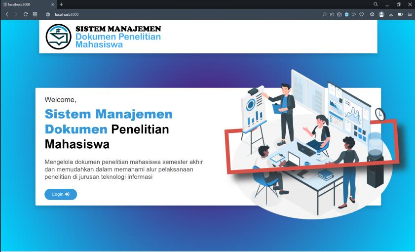
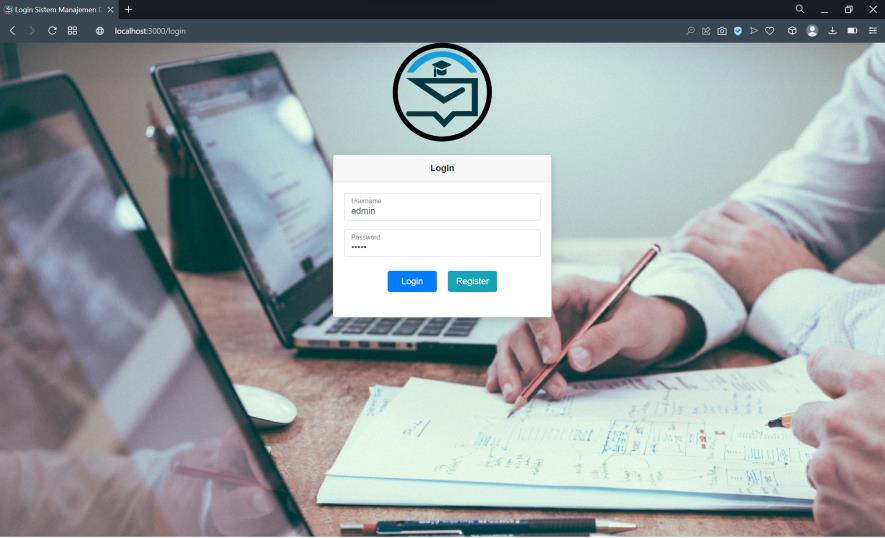
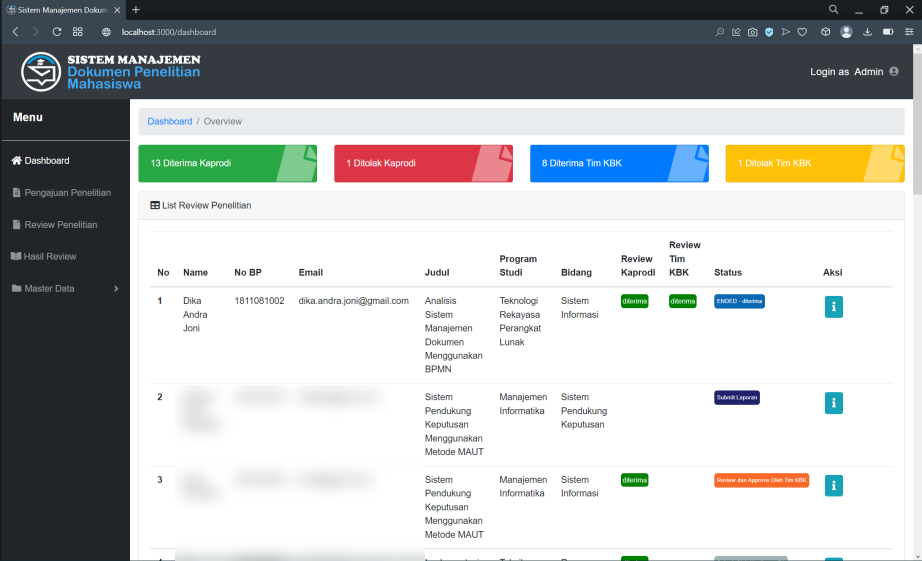
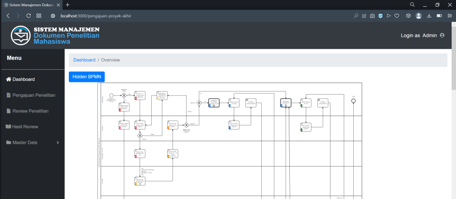
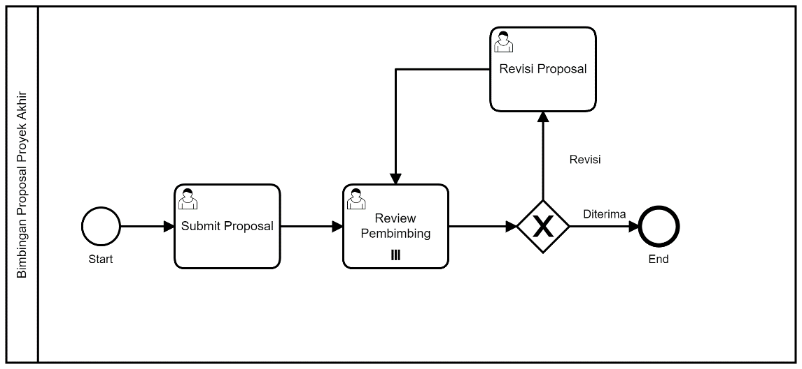
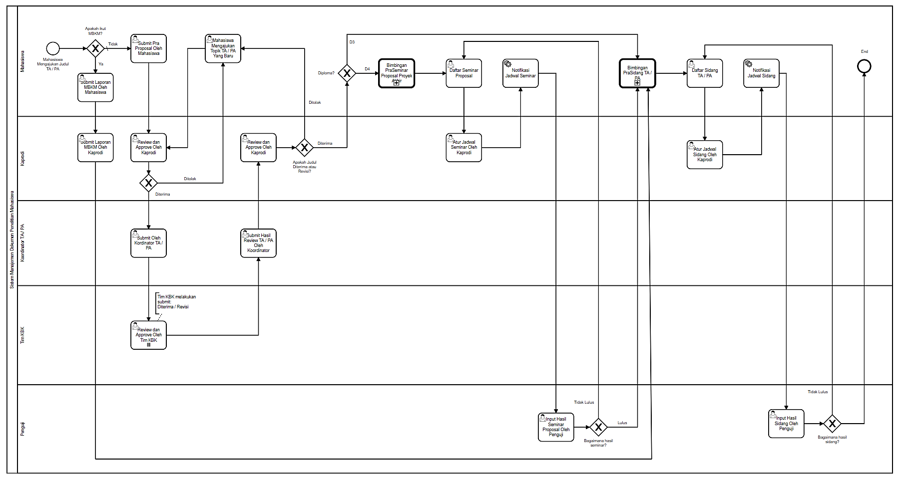
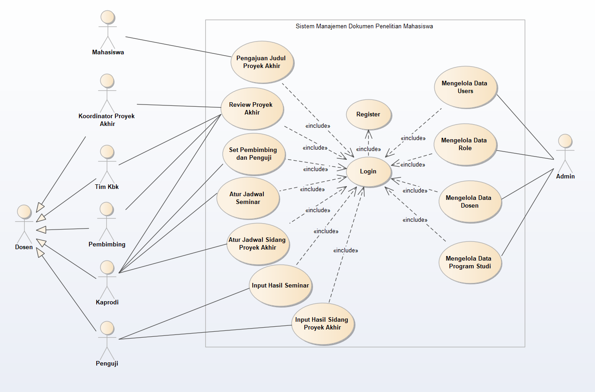

# Sistem Manajemen Dokumen Proyek Akhir (BPMN)

Proyek Akhir D4 Teknologi Rekayasa Perangkat Lunak, Politeknik Negeri Padang (2022) — Dika Andra Joni.

Aplikasi web untuk mengelola alur proyek akhir mahasiswa secara tersistem: pengajuan proposal, bimbingan,
review/revisi oleh dosen, sampai pengelolaan dokumen. Alur kerjanya dimodelkan dengan BPMN dan dijalankan
oleh workflow engine Camunda, sehingga setiap tahap (submit → review → revisi → disetujui) tercatat dan
bisa dilacak.



## Tampilan

| Login | Dashboard |
|---|---|
|  |  |

**Pengajuan penelitian dengan viewer BPMN**: mahasiswa melihat posisi pengajuannya langsung di diagram proses.



**Proses bisnis yang dijalankan Camunda**



<details>
<summary>BPMN manajemen dokumen penelitian &amp; use case diagram</summary>




</details>

Screenshot diambil dari laporan proyek akhir; data mahasiswa lain di-blur.

## Fitur

- Login JWT dengan peran: admin, mahasiswa, dosen, kaprodi, tim KBK, pembimbing, penguji
- Pengajuan proposal proyek akhir dan alur review/revisi berbasis BPMN
- Bimbingan proposal dan bimbingan proyek akhir
- Upload dokumen dan tanda tangan ke object storage (MinIO / S3 compatible)
- Notifikasi email (template Thymeleaf)
- Master data: jurusan, program studi, bidang, dosen, mahasiswa, kategori
- Viewer diagram BPMN dan dokumen PDF di frontend, ekspor ke PDF/Excel

## Arsitektur

```
manajemen-pa-fe/      React 16 + MUI + bpmn-js  ──HTTP/JSON──▶  manajemen-dokumen/  Spring Boot 2.6 + Camunda 7.17
                                                                    │
                                                                    ├── PostgreSQL   (data aplikasi + engine Camunda)
                                                                    ├── MinIO        (file dokumen & tanda tangan)
                                                                    └── SMTP         (email notifikasi)
```

Proses BPMN ada di `manajemen-dokumen/src/main/resources/*.bpmn`:
`ManajemenDokumenProyekAkhir`, `BimbinganProposalProyekAkhir`, `BimbinganProyekAkhir`.

## Menjalankan secara lokal

Kebutuhan: JDK 11, Maven, Node.js, PostgreSQL, MinIO (opsional: MailHog untuk email).

**Backend**

```bash
cd manajemen-dokumen
cp .env.example .env        # isi JWT_SECRET, CAMUNDA_ADMIN_PASSWORD, DB_*, MINIO_*
set -a; . ./.env; set +a
mvn spring-boot:run         # http://localhost:8181, Camunda cockpit di /camunda
```

Semua konfigurasi dibaca dari environment variable (lihat `.env.example`); tidak ada kredensial di repo.

**Frontend**

```bash
cd manajemen-pa-fe
npm install
npm start                   # http://localhost:3000, API ke http://localhost:8181
```

## Catatan keamanan

Versi ini sudah dirapikan untuk portofolio: kredensial dipindah ke environment variable, password di-hash
dengan BCrypt, registrasi publik selalu mendapat peran `user`, dan header `User-ID` (bypass untuk testing)
hanya aktif jika `APP_MODE=dev`. Kontrol akses per endpoint (`@Secured`) baru diterapkan sebagian.
